# Boiler Room

> Door + motion lighting and gas leak alerting for the ground-floor boiler room.

**Package:** `boiler_room` | **Path:** `packages/areas/ground-floor/boiler-room/`
**Floor:** Ground floor (Parter) | **Area:** 3.33 m²

## How It Works

### Lighting

The light follows two sensors: the house-side door contact (`binary_sensor.boiler_room_door`) and the P1 motion sensor (`binary_sensor.boiler_room_occupancy`). Either one opening or tripping turns the light on instantly -- the door usually beats the PIR, so there is no wait on entry.

While the house door is open, the light stays on regardless of motion. Closing the door starts the exit path: the automation waits for motion to clear (the P1 is usually still on from the movement at the door), gives a 10-second grace, then switches off. If motion re-trips during that window -- someone closed the door from inside -- the run restarts and the light stays on.

The room has a second door to the garage with no contact sensor, so a closed house door does not mean the room is empty. With the house door closed, motion alone decides: the light goes off after 60 seconds of no motion. A 15-minute no-motion safety turns it off even if the house door is left open.

<!-- svg:keep -->

<!-- /svg:keep -->

### Gas leak alert

Gas detection sends an iOS critical alert to both phones (bypasses silent mode and Focus). Detector tamper or the detector going offline sends a regular push -- a dead detector is a silent failure of the only gas protection.

## Gotchas

- **P1 detection interval stays at 2 s.** A fast sensor is what lets the door-close path tell "walked out" from "shut myself in". The 60 s no-motion delay (not a longer P1 interval) covers standing still.
- **Old 10 s off was too short.** Visits are longer than the original "p95 < 10 s" estimate; standing still at the boiler for ~14 s used to drop the light mid-visit.
- **Garage-side entry is motion-only.** Coming in through the garage door has the normal PIR latency -- only the house door is sensored.
- No darkness check -- the room has no windows.

## Entities

## Dependencies

- `binary_sensor.boiler_room_door` -- house-side door contact (Aqara P2, Matter)
- `binary_sensor.boiler_room_occupancy` -- Aqara P1 motion sensor (Zigbee2MQTT)
- `light.boiler_room` -- ceiling light
- `binary_sensor.boiler_room_gas_detector_gas`, `binary_sensor.boiler_room_gas_detector_tamper` -- gas detector

## File Index

| File | Purpose |
|------|---------|
| `config.yaml` | Package entry point; includes the automations directory |
| `automations/boiler_room_lights_on_when_occupied.yaml` | Door + motion light: instant on, door-close exit, 60 s no-motion off, 15 min safety |
| `automations/boiler_room_gas_leak_alert.yaml` | Critical push on gas, warning on tamper / detector offline |
